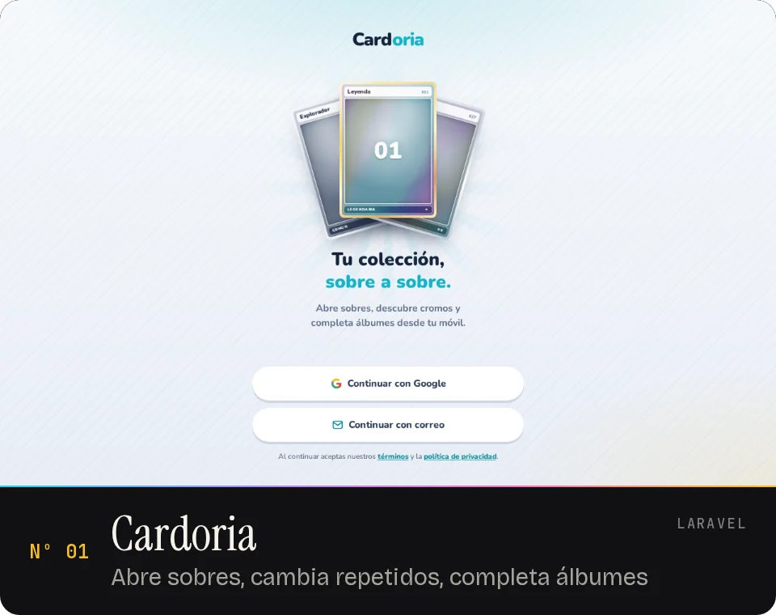
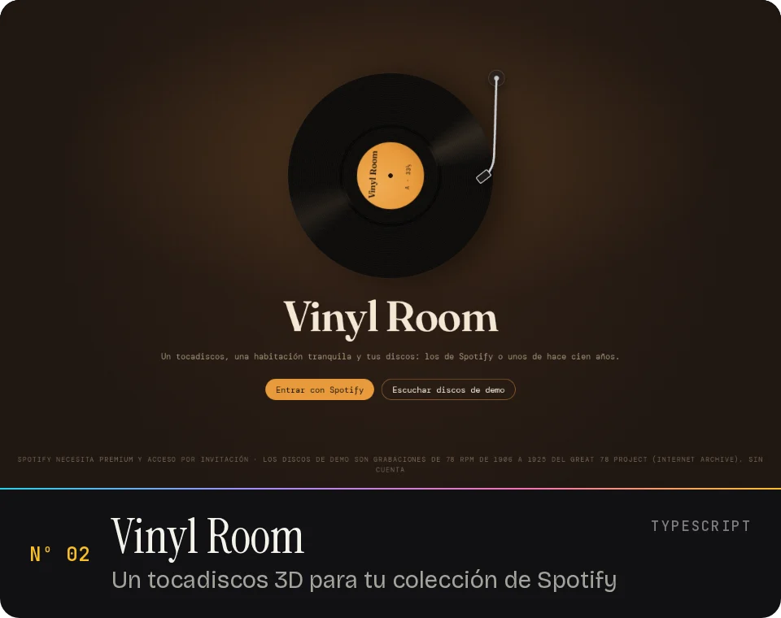
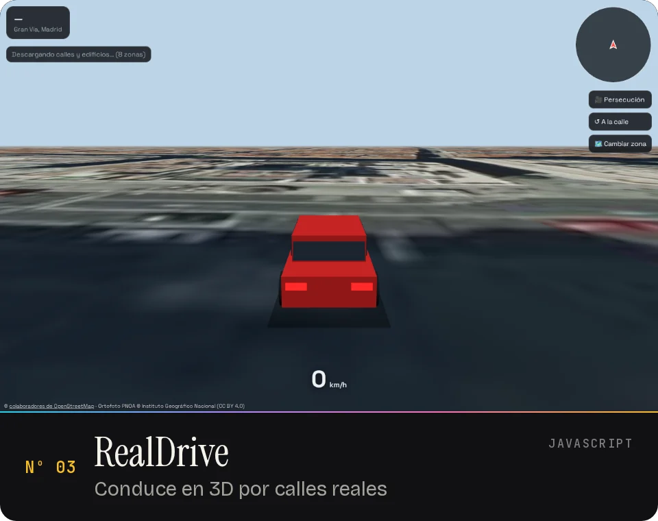
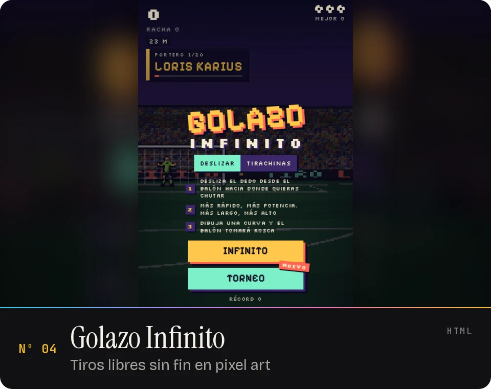
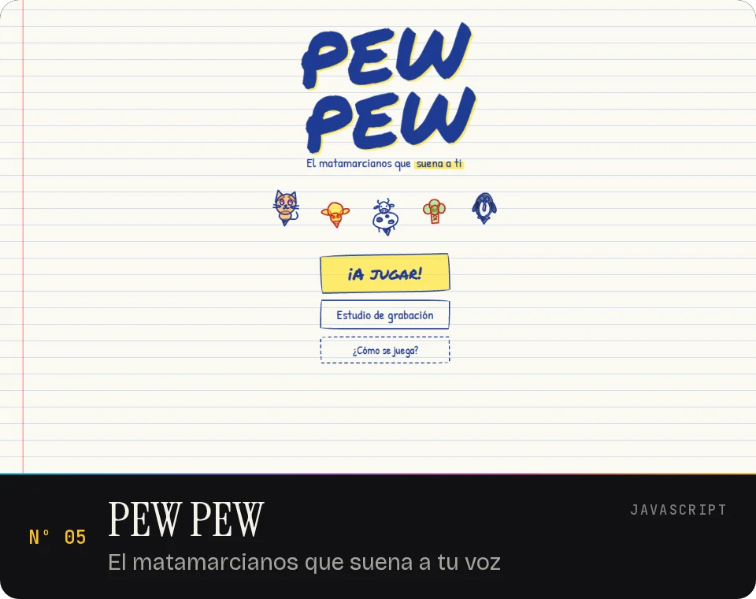
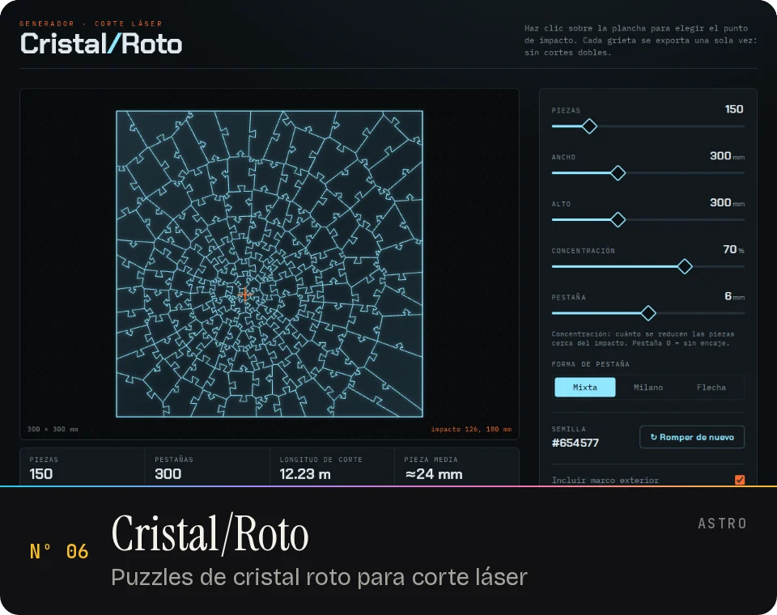
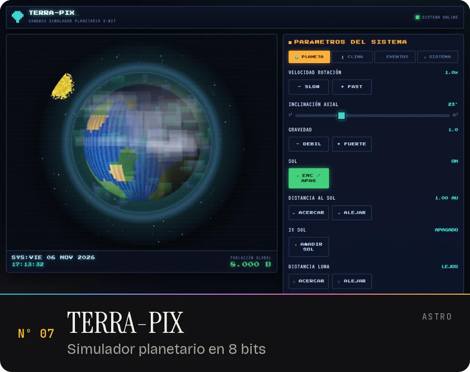
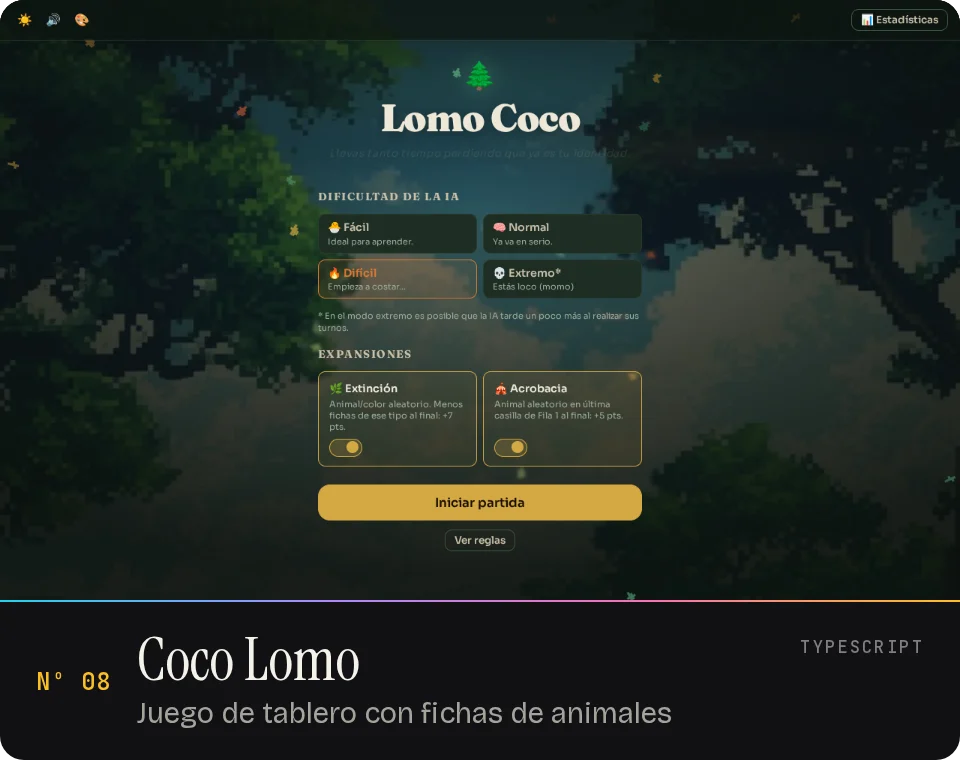

<picture>
  <source media="(prefers-color-scheme: dark)" srcset="https://raw.githubusercontent.com/Danuve3/Danuve3/6a5949d022f817efdc57753ff5c0e950cf2fdad4/assets/hero-dark.svg">
  <source media="(prefers-color-scheme: light)" srcset="https://raw.githubusercontent.com/Danuve3/Danuve3/6a5949d022f817efdc57753ff5c0e950cf2fdad4/assets/hero-light.svg">
  
</picture>

 

Y además: <a href="https://danuve3.github.io/mundiales-futbol/">Mundiales de Fútbol</a> &nbsp;·&nbsp; <a href="https://danuve3.github.io/soccer-cards/">Soccer Cards</a>
